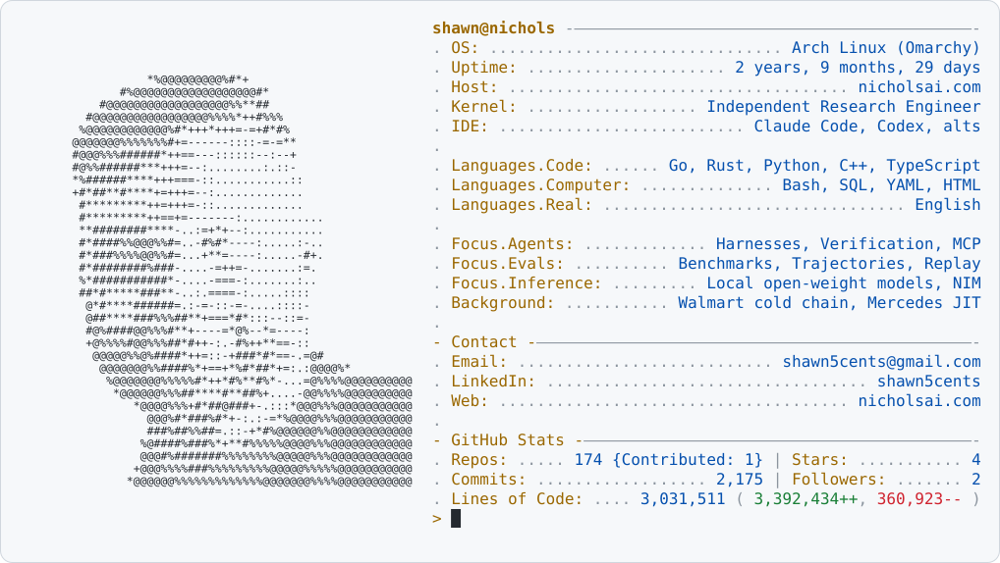

<a href="https://nicholsai.com">
  <picture>
    <source media="(prefers-color-scheme: dark)" srcset="./dark_mode.svg">
    
  </picture>
</a>

  <a href="https://nicholsai.com"><picture><source media="(prefers-color-scheme: dark)" srcset="./link_web_dark.svg"></picture></a>
  <a href="https://www.linkedin.com/in/shawn5cents"><picture><source media="(prefers-color-scheme: dark)" srcset="./link_linkedin_dark.svg"></picture></a>
  <a href="mailto:shawn5cents@gmail.com"><picture><source media="(prefers-color-scheme: dark)" srcset="./link_email_dark.svg"></picture></a>

<picture>
  <source media="(prefers-color-scheme: dark)" srcset="https://raw.githubusercontent.com/Shawn5cents/Shawn5cents/output/pacman-contribution-graph-dark.svg">
  
</picture>

<!--
Generated files: dark_mode.svg, light_mode.svg and link_*.svg come from tools/ via
.github/workflows/profile-card.yml; the Pac-Man graph is published to the `output`
branch by .github/workflows/pacman.yml. Edit tools/build_card.py to change the card text.
The ASCII portraits in assets/ were made once with tools/make_ascii.py (needs Pillow).
-->
